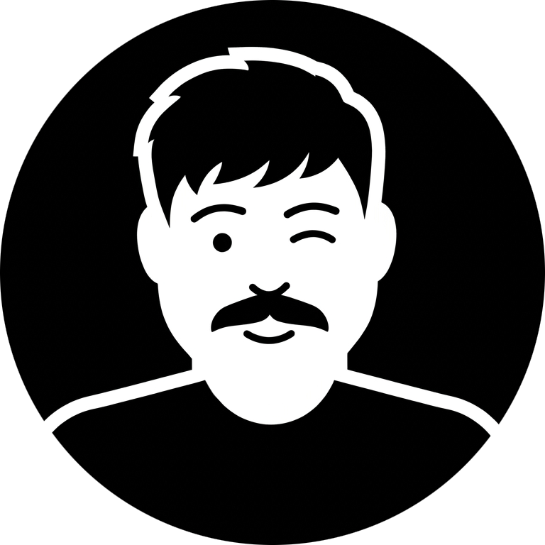

<p align="center">
  
</p>

<h1 align="center">Dario Saldamarco — Portfolio</h1>

<p align="center">
  UX/UI designer · dalla ricerca al prodotto finito<br>
  <a href="https://dariosaldamarco.com"><strong>dariosaldamarco.com</strong></a>
</p>

---

Il mio portfolio personale. Raccoglie i case study dei prodotti digitali che ho
progettato e, in molti casi, sviluppato: dalla ricerca con le persone ai flussi,
fino all'interfaccia e ai prototipi.

*English: personal portfolio of Dario Saldamarco, UX/UI designer. Bilingual
site (Italian / English) built with React, Vite and TypeScript, deployed on Vercel.*

## Cosa contiene

| Progetto | Tipo | Anno |
| --- | --- | --- |
| [Orby's Adventure](https://dariosaldamarco.com/projects/orbys-adventure) | Gioco educativo per iPad, con The Akanksha Foundation. Case study completo: analisi dei dati, test in classe a Pune, decisioni di design | 2026 |
| [You Can Only](https://dariosaldamarco.com/projects/you-can-only) | Gioco arcade per iPhone, progettato, sviluppato e pubblicato sull'[App Store](https://apps.apple.com/it/app/youcanonly/id6755528500) | 2026 |
| [Holo Studio](https://dariosaldamarco.com/tools/holo-card/) | Esperimento web: carta collezionabile olografica con file a livelli e parallasse 2.5D | 2026 |
| [Melting Pot](https://dariosaldamarco.com/projects/melting-pot) | Party game cooperativo per iPhone | 2025 |
| [Synk](https://dariosaldamarco.com/projects/synk) | Esperienza interattiva per iPhone | 2025 |
| [Sortie](https://dariosaldamarco.com/projects/sortie) | App di sleep coaching per iPhone | 2025 |
| [Bookmarked](https://dariosaldamarco.com/projects/bookmarked) | Social di lettura per iPhone | 2025 |

## Stack

- **React 19 + TypeScript + Vite**, senza framework di routing: un router minimo in `src/lib/router.ts`.
- **CSS puro** con design token (`src/styles/tokens.css`), niente librerie UI.
- **lucide-react** per le icone.
- **Bilingue IT / EN**: si apre nella lingua del browser, con selettore manuale (`src/i18n/`).
- **Vercel** per l'hosting: ogni push su `main` va online.

## Struttura

```
src/
├─ App.tsx                 rotte: home, case study, pagine legali di You Can Only
├─ components/
│  ├─ home/                home page (hero, progetti in evidenza, altri progetti, metodo, chi sono, CV)
│  ├─ layout/              navbar e footer contatti
│  └─ ui/                  icone app, crossfade
├─ pages/                  CaseStudyPage, supporto e privacy di You Can Only
├─ data/projects.ts        contenuti dei progetti (testi in IT e EN, immagini, link)
├─ i18n/                   traduzioni e contesto della lingua
├─ lib/                    router, animazioni allo scroll
└─ styles/                 token e stili globali
public/
├─ projects/               schermate e icone dei progetti
├─ img/holo-studio/        anteprima di Holo Studio
└─ cv/                     CV in PDF (IT, EN)
tools/
└─ holo-card/              Holo Studio, app Vite separata servita su /tools/holo-card/
scripts/postbuild.js       copia index.html nelle cartelle delle rotte (fallback per hosting statico)
```

Per aggiungere un progetto basta una voce in `src/data/projects.ts` e le
immagini in `public/projects/<id>/`.

## Rotte

| Percorso | Pagina |
| --- | --- |
| `/` | Home |
| `/projects/<id>` | Case study (es. `/projects/orbys-adventure`) |
| `/you-can-only/support` · `/you-can-only/privacy` | Pagine collegate all'App Store, da non spostare |
| `/tools/holo-card/` | Holo Studio |

## Sviluppo

```bash
npm install
npm run dev
```

```bash
npm run build     # type check, build del sito, build di Holo Studio, postbuild
npm run preview
npm run lint
```

`npm run build` compila anche `tools/holo-card` dentro `dist/tools/holo-card`;
le rewrite in `vercel.json` lo servono prima del fallback della single page app.
Holo Studio ha il suo README in [`tools/holo-card/README.md`](tools/holo-card/README.md).

## Contatti

- Sito: [dariosaldamarco.com](https://dariosaldamarco.com)
- Email e LinkedIn: nella sezione contatti del sito

## Licenza

Il codice è rilasciato con licenza [MIT](LICENSE). Testi, immagini dei progetti,
avatar e CV restano © Dario Saldamarco e non sono coperti dalla licenza.
